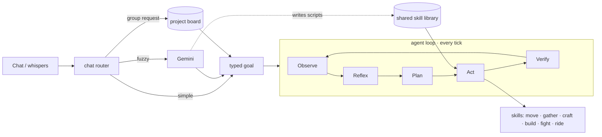

<div align="center">

# ⛏️ Minecraft Agents

**AI players that join your Minecraft world and play *with* you, like real teammates.**

They talk in chat, pick a leader, split up big builds, fight side by side, dig in at night,
repair your village, ride ghasts — and teach each other the skills they learn.

[](https://github.com/thegauravgiri/minecraft-agents/actions/workflows/ci.yml)
[](LICENSE)
[](https://nodejs.org)

[Quick start](#-quick-start) · [What they can do](#-what-they-can-do) · [Talking to them](#-talking-to-them) · [How it works](#-how-it-works) · [Contributing](CONTRIBUTING.md)

</div>

<!-- Demo: drop a 20-30 s GIF here, e.g. docs/demo.gif — two agents building a flag, or one shouting "zombie on me!" and the other running over to help. -->

```text
<Steve>  Wren, build a cooking house here
<Wren>   Steve, building a cooking house right here!
<Vesper>   zombie on me at -490 30 - need help!
<Wren>   Vesper, hold on, coming!
<Wren>   Steve, back on the cooking house at -491 69 32.
<Steve>  everyone, renovate the village
<Vesper>   Village check: 6 buildings, 4 need repairs, 38 ground holes, paths to 9 doors.
          Jobs: repair building 1, repair building 2, fill the ground gaps, lay the village paths.
```

## Why this one?

Most Minecraft AI bots are **one bot following one player's commands**. Minecraft Agents is a **team**:

| | |
|---|---|
| 🧑‍🤝‍🧑 **A real team** | Ask several agents for something big and *one* of them takes the lead, plans it, and posts jobs on a shared board. The others claim jobs, report back, and pick up whatever a teammate dropped. |
| 🗣️ **Natural chat** | Plain English: "build a bridge across the river", "put your stuff in the chest", "come here and wait", "finish it with Vesper". Coordinates, "here" and "where I'm looking" are all understood. |
| 🛡️ **Survival instinct** | Agents eat, flee creepers, call for help when outnumbered, run to a teammate's rescue, sleep in a bed or dig in until daylight. |
| 🏗️ **Builders, not printers** | AI-designed structures are compiled to block plans and built progressively — survival gathers the materials batch by batch, creative flies and places. Repair, clean-up and village renovation are deterministic: holes get filled, junk gets removed, doorways get doors. |
| 📚 **Skills they share** | When the AI writes a script that works, it is saved to a shared library with a track record. The next agent reuses it; a failing skill gets repaired and the fix is saved for everyone. |
| 🧠 **Works without AI, too** | A typed planner (tech tree, crafting, smelting, digging, combat) does the heavy lifting. The LLM is used for understanding, design and novel tasks — so a quota hiccup slows them down instead of breaking them. |

## 🚀 Quick start

**You need:** Node.js 20+, Minecraft Java Edition (tested on **26.1.2**), and optionally a free [Gemini API key](https://aistudio.google.com/apikey).

```bash
git clone https://github.com/thegauravgiri/minecraft-agents.git
cd minecraft-agents
npm install
cp .env.example .env          # paste your GEMINI_API_KEY (optional but recommended)
```

1. Open a singleplayer world → **Esc → Open to LAN** → *Allow cheats: ON* → note the port.
2. Start one agent, or a whole team:

```bash
node bot.js <PORT> Vesper                  # one agent
./start-team.sh <PORT> Vesper Wren Cobalt  # a team (each one self-restarts if it crashes)
./stop-team.sh                            # everybody leaves
```

3. Say hi in chat: `Vesper come here`.

> A LAN world allows 8 players, so up to 7 agents plus you. Any offline-mode server works too (`MC_HOST`).

## 👥 Meet the crew

Start any of them by name, or any name you like: unknown names get a role too.

| Agent | Role | Loves |
|---|---|---|
| **Vesper** | leader | planning big projects and splitting the work |
| **Wren** | scout | exploring, finding villages, ore and water |
| **Cobalt** | miner | caves, iron, diamonds |
| **Gable** | builder | houses, towers, repairs |
| **Bramble** | lumberjack | wood, planks, clearing land |
| **Rook** | hunter | food, mob control, guarding the team |
| **Tinder** | smith | furnaces, tools and armour |

```bash
./start-team.sh <PORT> Vesper Wren Cobalt Gable
```

## 🎮 What they can do

- **Move & follow** — come / wait / follow / go to `x y z`, climb, pillar, bridge gaps, swim, escape holes, use doors
- **Gather & craft** — full tech tree from punching trees to iron gear, smelting, farming, hunting, chests (store / take / share)
- **Build** — houses, towers, statues, flags, farms, bridges across rivers; at the spot you stand on, look at, or name
- **Fix up** — repair holes, replace patched walls, add missing doors, remove junk, fill pits, lay dirt paths, renovate a whole village
- **Fight & survive** — team combat, creeper avoidance, call-for-help + rescue, eat, sleep, set spawn, burrow at night
- **Ride** — boats, minecarts, horses, and *driving happy ghasts* with passengers aboard
- **Live** — when nobody needs them they pick their own goals (tools, armor, food, exploring), chat with each other, and offer project ideas

## 💬 Talking to them

| You say | They do |
|---|---|
| `Vesper come here` | walk to you and wait there |
| `Wren build a small oak house where I'm looking` | design it, gather/craft materials, build it on that spot |
| `everyone build a village here` | a leader plans the jobs, the team splits them |
| `Wren, finish it with Vesper` | Wren continues its unfinished build, Vesper helps |
| `Vesper repair this house` / `fill the holes in the ground` | deterministic repair of what's actually broken |
| `put your stuff in the chest` | store items in the nearest chest |
| `drive the ghast to 100 120 -40` | fly the happy ghast there |
| `cancel all tasks` / `forget everything` | clear work / reset memory |

From the terminal: `./reset.sh [tasks|chat|all|everything] [names…]`.

## 🔧 How it works



- `src/core` — pure logic: tech-tree planner, structure DSL & compiler, survival reflexes, layout
- `src/runtime` — the agent loop, world observation, spatial reasoning, team inbox, project board
- `src/skills` — effectful actions (pathfinding, digging, placing, combat, riding, chests…)
- `src/brain` — LLM, chat routing, leader election, autonomy, banter, village planning, script director

Details: [ARCHITECTURE.md](ARCHITECTURE.md).

## ⚙️ Configuration

All settings live in `.env` (see [.env.example](.env.example)): API key and models, host/port, agent names, game mode (`creative`/`survival`/`keep`), autonomy and banter on/off. Each agent keeps its memory in `data/<name>/`; the team shares `data/shared/` and `skills/learned/`.

## 🧪 Tests

```bash
npm test                         # unit tests (planner, structures, reflexes, project board, skill library)
node test/e2e/<scenario>.js      # end-to-end scenarios against a local test server (see test/e2e/harness.js)
```

## ⚠️ Safety

The script director lets the AI write small JavaScript scripts and runs them inside a Node `vm` sandbox with a limited API. A `vm` is **not** a security boundary — run agents only on worlds and machines you trust, and never give them operator rights on a public server.

## 🤝 Contributing

Ideas, bug reports and pull requests are welcome — see [CONTRIBUTING.md](CONTRIBUTING.md). New skills, smarter builders and better teamwork are the most fun places to start. If you like the project, a ⭐ helps others find it.

## 🙏 Built with

This project stands on the shoulders of great open-source work:

| Library | Used for | License |
|---|---|---|
| [mineflayer](https://github.com/PrismarineJS/mineflayer) | the Minecraft client the agents play with | MIT |
| [mineflayer-pathfinder](https://github.com/PrismarineJS/mineflayer-pathfinder) | walking, climbing and digging paths | MIT |
| [minecraft-data](https://github.com/PrismarineJS/minecraft-data) | blocks, items, recipes per game version | MIT |
| [prismarine-item](https://github.com/PrismarineJS/prismarine-item) | item handling (chests, equipment slots) | MIT |
| [vec3](https://github.com/PrismarineJS/node-vec3) | 3D vector math | BSD |
| [@google/genai](https://github.com/googleapis/js-genai) | Gemini models for chat, design and planning | Apache-2.0 |
| [dotenv](https://github.com/motdotla/dotenv) | configuration from `.env` | BSD-2-Clause |

Inspired by research on LLM agents in Minecraft such as [Voyager](https://voyager.minedojo.org/) (skill libraries) and [Mindcraft](https://github.com/mindcraft-bots/mindcraft).
Minecraft is a trademark of Mojang Studios / Microsoft; this project is not affiliated with or endorsed by them.

## 📄 License

[MIT](LICENSE) © 2026 [Gaurav Giri](https://github.com/thegauravgiri)
